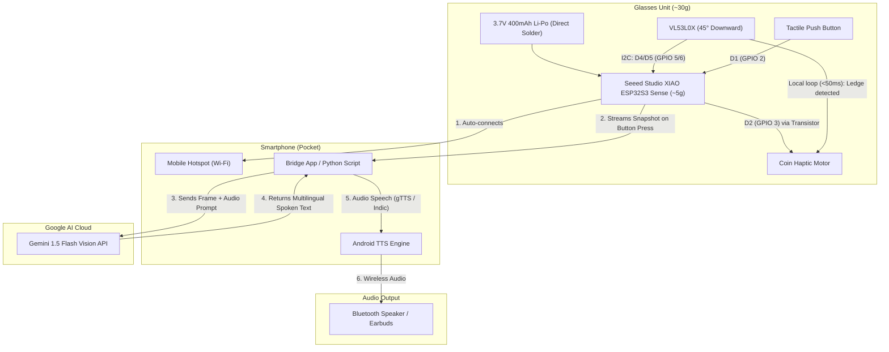

# SEVA: Smart Eyewear for Visual Assistance

> **Project Goal:** Build a working, wireless, wearable assistive vision device under **₹2,100** that delivers split-architecture edge-reflex hazard alerts and on-demand cloud scene intelligence using Google Gemini Vision.

---

## 1. System Architecture & Information Flow

The system divides responsibilities between **Instant Reflex** (local microsecond hazard warning) and **Deep Cognition** (cloud visual reasoning).



---

## 2. Hardware Bill of Materials (BOM) & Sourcing Checklist

| Item | Component | Specification | Vendor | Est. Cost (₹) | Checked |
| :---: | :--- | :--- | :--- | :---: | :---: |
| 1 | **MCU + Camera** | **Seeed Studio XIAO ESP32S3 Sense** (OV2640 + Digital Mic) | Robu.in / ElectronicsComp | ₹1,350 – ₹1,650 | [ ] |
| 2 | **Ledge/Drop Sensor** | ST VL53L0X Time-of-Flight (ToF) Sensor | Robu.in / ElectronicsComp | ₹250 – ₹380 | [ ] |
| 3 | **Battery** | 3.7V 400mAh – 500mAh Li-Po Pouch Cell | Robu.in / Amazon.in | ₹180 – ₹250 | [ ] |
| 4 | **Battery Charging** | **Built-in to XIAO board** (Solder to `BAT+`/`BAT-`) | Included on XIAO | ₹0 (Integrated) | [x] |
| 5 | **Haptic Feedback** | 10mm Coin Vibration Motor (3V) | ElectronicsComp / Local shop | ₹35 – ₹55 | [ ] |
| 6 | **Driver Circuit** | 1× BC547 NPN Transistor + 1kΩ Resistor | Local shop | ₹10 – ₹15 | [ ] |
| 7 | **Trigger Button** | 6×6mm Tactile Push Button | Local shop | ₹10 – ₹20 | [ ] |
| 8 | **Power Switch** | Mini SPDT Slide Switch | Local shop | ₹10 – ₹20 | [ ] |
| 9 | **Mounting & Wire** | 30 AWG Silicone Wires, Zip-ties, Double tape | Local shop / College lab | ₹50 – ₹100 | [ ] |
| **Total** | | | | **₹1,895 – ₹2,490** | |

---

## 3. Pin Mapping Table (Seeed Studio XIAO ESP32S3 Sense)

> **Important:** The XIAO ESP32S3 Sense expansion board uses internal connections for the OV2640 camera, digital PDM microphone, and SD card. Use only these verified exposed pins:

| Peripheral | Sensor Pin | XIAO Board Label | ESP32 GPIO | Purpose |
| :--- | :--- | :--- | :--- | :--- |
| **VL53L0X ToF** | `VCC` | `3V3` | 3.3V | Power |
| **VL53L0X ToF** | `GND` | `GND` | Ground | Common Ground |
| **VL53L0X ToF** | `SDA` | **`D4`** | `GPIO 5` | I2C Data line |
| **VL53L0X ToF** | `SCL` | **`D5`** | `GPIO 6` | I2C Clock line |
| **Tactile Button** | Pin 1 (Pin 2 to GND) | **`D1`** | `GPIO 2` | Input (`INPUT_PULLUP` enabled) |
| **Haptic Motor** | Transistor Base (via 1kΩ) | **`D2`** | `GPIO 3` | High triggers vibration ON |
| **3.7V Li-Po Battery** | `+` (via Switch) & `-` | **`BAT+` / `BAT-`** | Pads on bottom | Built-in recharge via USB-C |


---

## 4. Step-by-Step Implementation Roadmap

### Phase 1: Benchtop Breadboard Validation (Hours 1–4)
- [ ] **Step 1.1:** Flash basic blink and Wi-Fi scan on XIAO ESP32S3 using Arduino IDE to verify the board is functional.
- [ ] **Step 1.2:** Wire the VL53L0X sensor to `D4` (GPIO 5, SDA) and `D5` (GPIO 6, SCL). Run the Adafruit VL53L0X sample sketch and verify distance readings in the Serial Monitor.
- [ ] **Step 1.3:** Wire the BC547 transistor, 1kΩ resistor, and vibration motor to `D2` (GPIO 3). Test pulse vibration when distance is `< 300mm` (simulating a ledge/obstacle).
- [ ] **Step 1.4:** Wire the tactile push button between `D1` (GPIO 2) and `GND`. Verify button debouncing logic.

### Phase 2: Firmware Development (Hours 4–8)
- [ ] **Step 2.1:** Implement Wi-Fi auto-connect logic:
  ```cpp
  WiFi.begin("PhoneHotspotSSID", "HotspotPassword");
  ```
- [ ] **Step 2.2:** Configure XIAO camera initialization (`FRAMESIZE_SVGA` or `FRAMESIZE_VGA`, JPEG quality 12).
- [ ] **Step 2.3:** Set up a lightweight HTTP server on the ESP32:
  * `/capture` endpoint returns the current JPEG frame as a binary stream.
  * `/status` endpoint returns current ToF distance and battery level.
- [ ] **Step 2.4:** Fast FreeRTOS Task for Hazard Detection:
  * Background loop checks ToF every 40ms.
  * If distance reading jumps suddenly (>40cm increase = drop-off / stairs down) or drops (<30cm = head-level collision), trigger haptic motor for 250ms.

### Phase 3: Phone/Laptop Bridge & Gemini Integration (Hours 8–12)
- [ ] **Step 3.1:** Create the backend script (Python on laptop/Termux, or lightweight web app on mobile browser).
- [ ] **Step 3.2:** Configure Gemini API SDK with Multimodal Audio + Vision support.
- [ ] **Step 3.3:** Enable Multilingual Prompting (Marathi, Konkani, Hindi, Gujarati, English).
- [ ] **Step 3.4:** Pipe response into gTTS / Indic Text-to-Speech -> Route audio to connected Bluetooth speaker.

### Phase 4: Physical Integration & Ergonomics (Hours 12–16)
- [ ] **Step 4.1:** Mount the 400mAh battery on the **left temple** of the glasses frame using double-sided mounting tape.
- [ ] **Step 4.2:** Mount the miniature XIAO ESP32S3 Sense on the **right temple** (weighs only ~5g!).
- [ ] **Step 4.3:** Mount VL53L0X angled **45° downwards** near the front hinge.
- [ ] **Step 4.4:** Run lightweight 2-conductor wire across the top rim of the frame to connect battery directly to the XIAO `BAT+`/`BAT-` pads.
- [ ] **Step 4.5:** Tape coin vibration motor inside the right temple tip so it presses gently against the mastoid/skin.

### Phase 5: Rehearsal & Live Demo Polish (Hours 16–20)
- [ ] **Step 5.1:** Perform latency testing (aim for < 1.8 seconds from button click to voice response).
- [ ] **Step 5.2:** Test edge reflex response time on mock step/table edge (aim for < 50ms haptic tap).
- [ ] **Step 5.3:** Create a 1-page backup poster/slide and record a 30-second backup video on phone in case venue Wi-Fi fails.

---

