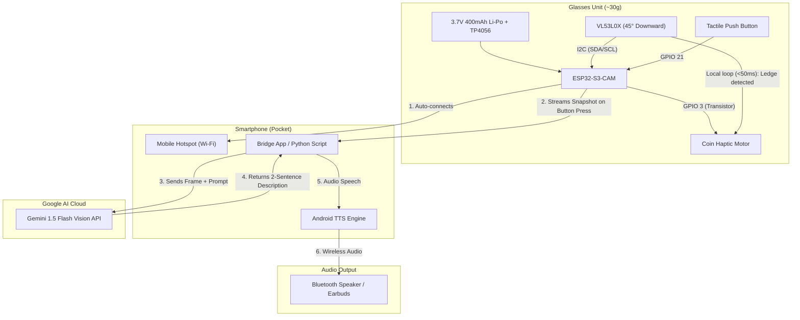

# SEVA: Smart Eyewear for Visual Assistance
## Hackathon Execution Plan (Argus-Inspired Wireless MVP)

> **Project Goal:** Build a working, wireless, wearable assistive vision device under **₹2,100** that delivers split-architecture edge-reflex hazard alerts and on-demand cloud scene intelligence using Google Gemini Vision.

---

## 1. System Architecture & Information Flow

The system divides responsibilities between **Instant Reflex** (local microsecond hazard warning) and **Deep Cognition** (cloud visual reasoning).



---

## 2. Hardware Bill of Materials (BOM) & Sourcing Checklist

| Item | Component | Specification | Vendor | Est. Cost (₹) | Checked |
| :---: | :--- | :--- | :--- | :---: | :---: |
| 1 | **MCU + Camera** | ESP32-S3-CAM (N16R8) with OV2640 / OV3660 | Robu.in / ElectronicsComp | ₹1,050 – ₹1,200 | [ ] |
| 2 | **Ledge/Drop Sensor** | ST VL53L0X Time-of-Flight (ToF) Sensor | Robu.in / ElectronicsComp | ₹250 – ₹380 | [ ] |
| 3 | **Battery** | 3.7V 400mAh – 500mAh Li-Po Pouch Cell | Robu.in / Amazon.in | ₹180 – ₹250 | [ ] |
| 4 | **Charger Board** | TP4056 Type-C with Battery Protection | Local shop / Robu.in | ₹35 – ₹50 | [ ] |
| 5 | **Haptic Feedback** | 10mm Coin Vibration Motor (3V) | ElectronicsComp / Local shop | ₹35 – ₹55 | [ ] |
| 6 | **Driver Circuit** | 1× BC547 NPN Transistor + 1kΩ Resistor | Local shop | ₹10 – ₹15 | [ ] |
| 7 | **Trigger Button** | 6×6mm Tactile Push Button | Local shop | ₹10 – ₹20 | [ ] |
| 8 | **Power Switch** | Mini SPDT Slide Switch | Local shop | ₹10 – ₹20 | [ ] |
| 9 | **Mounting & Wire** | 30 AWG Silicone Wires, Zip-ties, Double tape | Local shop / College lab | ₹50 – ₹100 | [ ] |
| **Total** | | | | **₹1,630 – ₹2,090** | |

---

## 3. Pin Mapping Table (ESP32-S3)

> **Important:** The ESP32-S3-CAM uses multiple internal GPIOs for the camera's 8-bit parallel bus and DVP clock. Do **not** reassign camera pins. Use only these verified external GPIOs:

| Peripheral | Peripheral Pin | ESP32-S3 Pin | Purpose |
| :--- | :--- | :--- | :--- |
| **VL53L0X ToF** | `VCC` | `3V3` | Power |
| **VL53L0X ToF** | `GND` | `GND` | Ground |
| **VL53L0X ToF** | `SDA` | `GPIO 1` | I2C Data line |
| **VL53L0X ToF** | `SCL` | `GPIO 2` | I2C Clock line |
| **Tactile Button** | Pin 1 | `GPIO 21` | Input (`INPUT_PULLUP` enabled) |
| **Tactile Button** | Pin 2 | `GND` | Pulls to GND when pressed |
| **Haptic Motor** | Base (via 1kΩ) | `GPIO 3` | High triggers transistor ON |
| **TP4056 Out+** | `OUT+` (via Switch) | `5V` or `VBUS` | Powers the board |
| **TP4056 Out-** | `OUT-` | `GND` | Common Ground |

---

## 4. Step-by-Step Implementation Roadmap

### Phase 1: Benchtop Breadboard Validation (Hours 1–4)
- [ ] **Step 1.1:** Flash basic blink and Wi-Fi scan on ESP32-S3 using Arduino IDE or ESP-IDF to verify the board is functional.
- [ ] **Step 1.2:** Wire the VL53L0X sensor to `GPIO 1` (SDA) and `GPIO 2` (SCL). Run the Adafruit VL53L0X sample sketch and verify distance readings in the Serial Monitor.
- [ ] **Step 1.3:** Wire the BC547 transistor, 1kΩ resistor, and vibration motor to `GPIO 3`. Test pulse vibration when distance is `< 300mm` (simulating a ledge/obstacle).
- [ ] **Step 1.4:** Wire the tactile push button between `GPIO 21` and `GND`. Verify button debouncing logic.

### Phase 2: Firmware Development (Hours 4–8)
- [ ] **Step 2.1:** Implement Wi-Fi auto-connect logic:
  ```cpp
  WiFi.begin("PhoneHotspotSSID", "HotspotPassword");
  ```
- [ ] **Step 2.2:** Configure ESP32 camera initialization (`FRAMESIZE_VGA` or `FRAMESIZE_SVGA`, JPEG quality 12).
- [ ] **Step 2.3:** Set up a lightweight HTTP server on the ESP32:
  * `/capture` endpoint returns the current JPEG frame as a binary stream.
  * `/status` endpoint returns current ToF distance and battery level.
- [ ] **Step 2.4:** Fast FreeRTOS Task for Hazard Detection:
  * Background loop checks ToF every 40ms.
  * If distance reading jumps suddenly (>40cm increase = drop-off / stairs down) or drops (<30cm = head-level collision), trigger haptic motor for 250ms.

### Phase 3: Phone/Laptop Bridge & Gemini Integration (Hours 8–12)
- [ ] **Step 3.1:** Create the backend script (Python on laptop/Termux, or lightweight web app on mobile browser).
- [ ] **Step 3.2:** Configure Gemini API SDK:
  ```python
  import google.generativeai as genai
  genai.configure(api_key="YOUR_GEMINI_API_KEY")
  model = genai.GenerativeModel("gemini-1.5-flash")
  ```
- [ ] **Step 3.3:** Craft the assistive system prompt:
  > *"You are the visual assistant for a blind person wearing smart glasses. In 1 to 2 crisp, conversational sentences, describe the most important obstacle, object, or person directly in front. If text is prominent, read it. Never output markdown asterisks or bullet points."*
- [ ] **Step 3.4:** Pipe response into Text-to-Speech (TTS) -> Route audio to connected Bluetooth speaker.

### Phase 4: Physical Integration & Ergonomics (Hours 12–16)
- [ ] **Step 4.1:** Mount battery & TP4056 module on the **left temple** of the glasses frame using double-sided mounting tape.
- [ ] **Step 4.2:** Mount ESP32-S3-CAM on the **right temple**.
- [ ] **Step 4.3:** Mount VL53L0X angled **45° downwards** near the front hinge.
- [ ] **Step 4.4:** Run a lightweight 2-conductor wire across the top rim of the frame to deliver power from left battery to right MCU.
- [ ] **Step 4.5:** Tape coin vibration motor inside the right temple tip so it presses gently against the mastoid/skin.

### Phase 5: Rehearsal & Live Demo Polish (Hours 16–20)
- [ ] **Step 5.1:** Perform latency testing (aim for < 1.8 seconds from button click to voice response).
- [ ] **Step 5.2:** Test edge reflex response time on mock step/table edge (aim for < 50ms haptic tap).
- [ ] **Step 5.3:** Create a 1-page backup poster/slide and record a 30-second backup video on phone in case venue Wi-Fi fails.

---

## 5. The Hackathon Demo Script (2-Minute Pitch)

1. **The Hook (0:00 – 0:25):**
   * *"Over 40 million visually impaired people worldwide rely on white canes that cannot read labels, identify faces, or detect head-level obstacles. Existing assistive glasses like OrCam cost over ₹3,00,000, weigh down the face, and run out of battery in an hour."*
2. **The Innovation (0:25 – 0:50):**
   * *"Inspired by the 2025 Microsoft Imagine Cup Champion 'Argus', we built **SEVA**—a split-architecture assistive vision device that weighs under 32 grams, is 100% wireless, and costs less than ₹2,100 to build."*
3. **Live Demonstration 1: Instant Edge Reflex (0:50 – 1:15):**
   * Put on glasses. Walk towards the edge of the judges' table or step.
   * Point out the downward 45° ToF sensor: *"Without touching the internet, the glasses instantly vibrate to warn me of the drop-off in under 40 milliseconds."*
4. **Live Demonstration 2: Gemini Cognitive Intelligence (1:15 – 1:45):**
   * Look at a judge or an object (e.g., a medicine bottle or ID card).
   * Tap the temple button. 
   * Speaker says aloud: *"You are looking at a hand sanitizer bottle placed next to a blue laptop."*
5. **The Punchline (1:45 – 2:00):**
   * *"By offloading heavy AI to Google Gemini and using the phone already in every user's pocket, we slashed the cost by 99% without sacrificing a single gram of comfort. Thank you!"*
